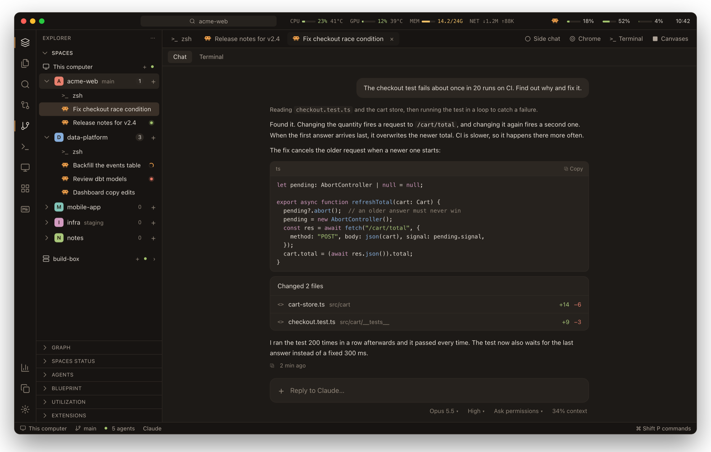
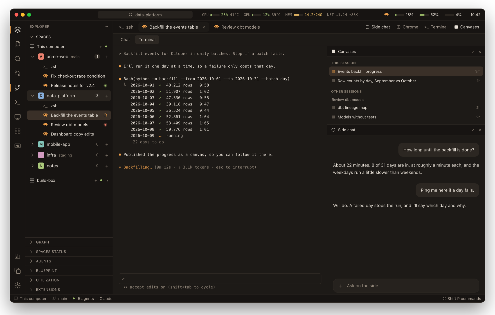
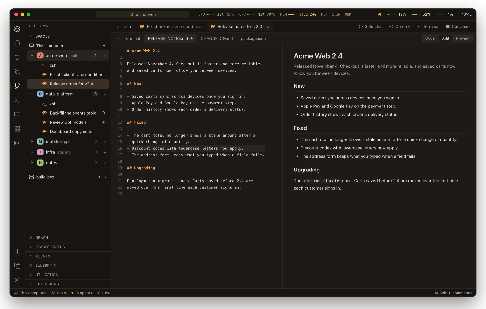
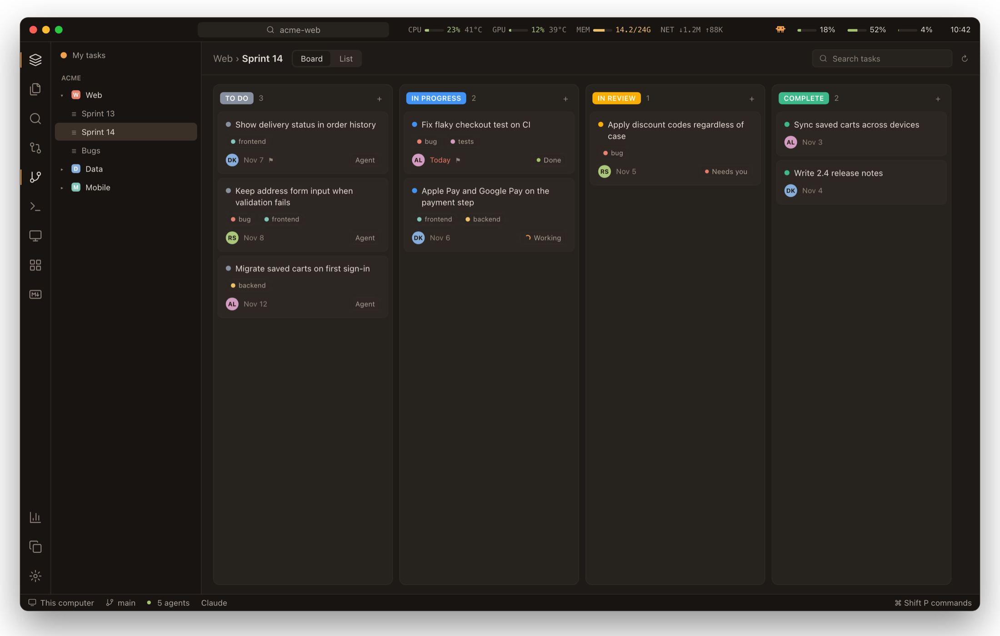

<div align="center">

# herdr-setup

**A VS Code-style home for running many Claude Code sessions side by side.**

Alon's setup of the [Herdr](https://herdr.dev) desktop app: every session is a terminal you can
also read and answer as a chat, grouped by project, with the tools each one needs beside it.

</div>

<picture>
  <source media="(prefers-color-scheme: light)" srcset="docs/screens/chat-light.png">
  
</picture>

<sub>All screenshots here are mocks with made-up projects and sessions, drawn to match the real window (`docs/screenshot.html`).</sub>

## What you get

This repo *is* the app's home folder, `~/.config/herdr-app`. Herdr redraws the window live from
these files, so a change here shows up as soon as it's saved. The main layout is `vscode`, in the
Ember theme (amber, light and dark).

### Sessions that tell you when they need you

- **Spaces** group sessions by project, each with its git branch and how many agents are running.
- A session that's **asking you something** or **finished while you were away** has a softly
  breathing dot. Only that one breathes; it stops once you've looked.
- Claude tabs **name themselves** after their session title, like the Claude desktop app.
- **Drag** a session within its space to reorder it; right-click for the rest.

### Read a session as a chat

- Any Claude Code session can be shown as its **terminal** or as a **chat**, built from its
  transcript: replies in Markdown, code blocks, changed files with their line counts.
- Scroll up and **older messages load** on their own. Answer from the box at the bottom.

### Tools beside each session

| | |
|---|---|
| **Side chat** | A second chat next to the main one |
| **Chrome** | A real browser, in a pane |
| **Terminal** | A shell for the same session |
| **Canvases** | The claude.ai pages the session published, opened in place |

Any of them can move into the main area and back.

<picture>
  <source media="(prefers-color-scheme: light)" srcset="docs/screens/tools-light.png">
  
</picture>

### Files next to their session

- Click a file in Explorer or the Markdown list and it opens as a tab **under the session** that
  you're in. Switch sessions and their files switch with them.
- The editor follows the disk while you haven't typed, saves with ⌘S, and marks unsaved files.
- Markdown opens in **Code, Split or Preview**, like VS Code (⌘⇧V toggles Preview).

<picture>
  <source media="(prefers-color-scheme: light)" srcset="docs/screens/editor-light.png">
  
</picture>

### Around the edges

- **Title bar:** a command box, CPU, GPU, memory and network, Claude usage and quota.
- **Side bar sections:** Explorer, Search, Markdown, Git changes and graph, Agents, Blueprint
  (an agent's flow as a diagram), Utilization, Extensions. Drag to reorder, collapse, resize.
- **Boards:** ClickUp and Linear managed in place; start an agent straight from a task.

### ClickUp, without leaving the window

Your spaces and lists, each as a **Board** or a **List**. Drag a card to change its status, click it
to edit everything in a side panel, or press **Agent** to start a Claude session on it in its own
worktree. The card then shows how that agent is doing.

<picture>
  <source media="(prefers-color-scheme: light)" srcset="docs/screens/board-light.png">
  
</picture>

## What's here

| Path | What |
|---|---|
| `layouts/` | Window layouts. `vscode.json` is the main one; `cmd-shift-l` cycles through them |
| `themes/` | Ember (dark and light) and the other themes the layouts use |
| `mods/` | The window's parts, in JavaScript on gpui-kit (drawn natively, no DOM). Herdr ships some; the rest are made here |
| `keys.json` | Keyboard shortcuts |
| `settings.json` | Zoom, font size, sounds |
| `backgrounds/`, `icons/` | Images the layouts and mods use |
| `docs/` | The README's screenshots (`screens/`) and the page they're drawn from |
| `CLAUDE.md` | Rules for Claude sessions editing this folder |
| `ARCHITECTURE.md` | How the `vscode` layout fits together, and the shared-state keys mods talk through |
| `AGENTS.md`, `*.d.ts`, `frame/` | Herdr's own manual and API types. The app rewrites them; don't edit |

<details>
<summary><b>The mods made here</b></summary>

| Mods | Do |
|---|---|
| `vs-chrome`, `vsections`, `tabs-vs`, `session-files`, `tool-header` | Title bar, activity bar, side bar sections, session and file tabs, tool headers |
| `spaces-tree`, `session-menu` | Spaces with their sessions; right-click menu |
| `chat`, `side-chat` | A Claude Code session as a chat, read from its transcript |
| `canvases`, `browser` | Published claude.ai pages, and the Electron browser that shows them |
| `files-plus`, `editor`, `markdown-browser`, `term-search` | Explorer, code editor, Markdown list and preview, search |
| `changes-vs`, `git-graph`, `blueprint`, `servers`, `sysmon`, `quota`, `usage-bar` | Git changes and graph, an agent's flow, servers, system load, Claude usage |
| `clickup-board`, `linear-board`, `forge-*` | ClickUp, Linear, GitLab and GitHub panels |
| `insights`, `extensions`, `customize` | Claude Code usage, plugins and skills |

</details>

## Set up on a new Mac

1. Install Herdr, start it once, then quit it.
2. Put this repo in its place:
   ```sh
   mv ~/.config/herdr-app ~/.config/herdr-app.orig
   git clone git@github.com:alws34/herdr-setup.git ~/.config/herdr-app
   ```
3. Install the browser's Electron, used by the Chrome tool and Canvases:
   ```sh
   cd ~/.config/herdr-app/mods/browser/shell && npm install
   ```
4. For the ClickUp board, put a personal API token in `~/.config/herdr-app/clickup-board.json`
   as `{"token": "pk_..."}`.
5. Start Herdr and pick the `vscode` layout (`cmd-shift-l`).

> [!NOTE]
> The first canvas sign-in asks macOS for the "Claude Safe Storage" keychain item, to reuse the
> Claude desktop app's claude.ai login. Always Allow avoids repeats.

## Not in git

`.gitignore` keeps these out:

- `data/`: chat screenshots, browser profiles and cookies.
- `clickup-board.json`: holds the ClickUp token.
- State the app rewrites: `shared.json`, `view.json`, `layouts/.state/` and others.
- `node_modules/`.

> [!WARNING]
> Never commit tokens, cookies or keys.

## Changing it

Read `CLAUDE.md` first. In short:

- Don't edit Herdr's shipped mods or layouts (the names in `installed.json`); clone them instead.
- After changing a mod, run `herdr-app check ~/.config/herdr-app/mods/<name>`.
- `herdr-app status` shows errors; `herdr-app shot x.png` saves the window's last frame.
- If a layout breaks the window, `ctrl-alt-shift-escape` gets you out.
- To redraw the README's screenshots after editing `docs/screenshot.html`, render
  `screenshot.html#<screen>` (`chat`, `tools`, `editor`, `board`, each also with `-light`) at
  1568×998 with Chrome headless (`--force-device-scale-factor=2`) into `docs/screens/`.
